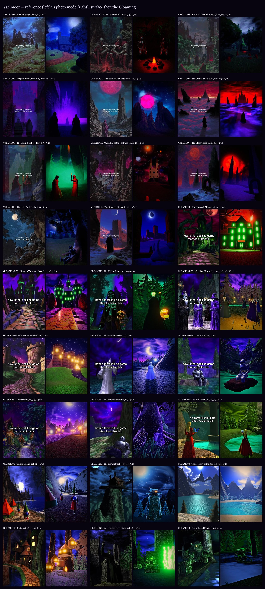

# Vaelmoor

A first-person fantasy RPG for the browser, built with Three.js. It uses ES modules and an import map with no build step, and is hostable as-is on GitHub Pages.

The world has two layers, each with its own look:

| Layer | Region file | Look |
| --- | --- | --- |
| **Vaelmoor**, the surface | `data/regions/surface.json` | 80s dark-fantasy oil painting: matte, grainy, deep blue and black with blood-red accents, big pale moons, mist. Corrupted pockets turn purple, crimson and magenta. |
| **The Gloaming**, the underworld | `data/regions/gloaming.json` | Early-2000s fantasy RPG remembered in a dream: glossy, saturated, glowing, with harsh HDR-style local contrast. |

You go down into the Gloaming through the **barrow door** on the surface (follow the compass marker for *Beneath Vaelmoor*). The two looks crossfade over a few seconds, like waking into a dream. A recording is in [`docs/transition/barrow.webm`](docs/transition/barrow.webm).



## Run it

```sh
npx serve .
```

Then open the printed URL. Any static server works; the game just can't be opened from `file://`.

## Playing

Vaelmoor is a first-person RPG in the old mould. Ten skills (One-Handed, Block, Archery, Destruction, Restoration, Sneak, Lockpicking, Speech, Alchemy and Smithing) rise as you use them, and your character level rises with them. Each level-up gives +10 to health, magicka or stamina and a perk point for that skill's constellation. Chests, barrels, sacks and bodies can be searched (take one with E, everything with R); locked ones need a lockpick and a steady hand. Merchants buy and sell at prices set by your Speech. Fights are light but physical: swings and power attacks, timed blocks that stagger, arrows that drop, Flames and Healing from either hand. Wolves roam the surface, Hollow Ones guard the barrow and shades drift through the Gloaming; each one notices you, gives chase, telegraphs its blows and sometimes flees. If you die, the screen fades and the last save loads. Items, loot tables, skills, perks and spells all live in `data/`.

## Controls

| Key | Action |
| --- | --- |
| Any key / click | Leave the title screen |
| W A S D, mouse | Move, look |
| Shift | Sprint (uses stamina) |
| Space | Jump |
| E | Use what the crosshair is on: talk, take, search, unlock, read |
| Tab | Menu: Skills / Items / Magic / Map |
| I | Items: categories, 3D preview, equip (E right hand, R left hand), favorite (F), drop (X) |
| P | Magic: put Flames or Healing in either hand |
| K | Skills: constellations and perks; level-ups choose +10 health, magicka or stamina |
| Q | Favorites: quick-switch what each hand holds |
| Left mouse | Right hand: swing (hold for a power attack), draw and loose a bow, cast |
| Right mouse | Left hand: block (shield, or your blade if the left hand is empty), cast; with a bow, zoom (Eagle Eye) |
| Left mouse while blocking | Shield bash |
| C | Sneak: lower and slower; an eye shows how close foes are to seeing you; unaware foes take 3x melee / 2x arrow damage |
| R | Draw / sheathe |
| J | Journal |
| Esc | Pause menu (resume, journal, save, load, settings, quit) |
| F3 | FPS overlay |
| F2 | Photo-mode menu: every reference shot in both layers |
| 1–9 | Photo mode: Gloaming shots 1–9 |
| Shift+1–9, Shift+0 | Photo mode: surface shots 1–10 |
| 0 | Leave photo mode (moving also leaves it) |

**Settings** (from the pause menu) has the **Low / Medium / High** quality presets, the FPS toggle, mouse sensitivity, field of view, head bob and invert look. Settings are saved in the browser. Resolution also adapts automatically to hold 60 fps within the preset's cap.

**URL flags:**
- `?region=gloaming` starts underground.
- `?play` skips the title screen.
- `?shot=surface:3` opens straight into a photo-mode shot.
- `?nohud` hides the UI.
- `?quality=1.25` pins the pixel ratio.
- `?nopaint` turns off the painterly and sharpen passes (handy for before/after comparisons).

## How the looks are made

Each region names a **render profile** (`"renderProfile": { "kind": "painted" }`), and can override any field of it. The renderer blends profiles field by field and crossfades them, together with post settings and exposure, when a portal moves you between realms (`src/world/profiles.js`, `src/main.js`).

- **Painted (surface):** a half-resolution structure tensor feeds an anisotropic Kuwahara filter for the brush strokes. The full-resolution composite then adds:
  - canvas weave, soft posterize and dark brush contours;
  - an oil-paint grade (shadows to indigo, highlights to cold moonlight, reds kept saturated);
  - heavy grain and a strong vignette.

  Brush resolution and radius follow the quality preset (`src/render/painterly.js`).
- **Dream (Gloaming):** a "dream sharpen" pass runs before bloom. It is a two-radius unsharp mask on HDR log-luminance, which gives the harsh local contrast. Then bloom, ACES tone mapping and a saturated grade (`src/render/sharpen.js`, `src/render/post.js`).
- **Shared:** a painterly sky shader (domain-warped clouds, moons, planets, nebula, aurora), analytic height fog, a pooled point-light system, per-area palettes blended by distance, and every shader compiled at load so areas never hitch.

## UI

All UI is plain HTML/CSS in a quiet, shipped-RPG style: bone text on fading black, thin rules with a diamond, condensed caps and a serif for titles. There is no glow, blur or boxes. The kit lives in `src/ui/kit.css` and `src/ui/kit.js`, and every screen is built from it:
- HUD (compass, vitals bars, crosshair, prompts, discovery popup)
- dialogue
- pause menu
- parchment journal
- settings
- title screen
- photo menu

Quests and dialogue are data: `data/quests.json` and `data/dialogue.json`.

## Project layout

```
index.html               import map, canvas, UI root
src/main.js              realms, game loop, profile crossfade, quality presets
src/engine/              renderer, assets, input, noise
src/render/              post chain, painterly + sharpen passes, height fog, light pool
src/shaders/             sky dome, shared GLSL noise
src/world/               realms, profiles, terrain, road, water, vegetation, buildings,
                         surface.js (painted props), gloaming2.js (ref_11..17 props),
                         humans.js (rigged CC0 characters: outfits, robes, props, clips)
src/player/              first-person controller, photo mode
src/game/                quests, vitals, settings, interaction targets, storage
src/ui/                  UI kit and screens
data/regions/*.json      the worlds as data (surface.json is generated by tools/regions/surface.cjs)
tools/                   screenshot, compare, perf, walk, UI-shot and transition-recording scripts;
                         tools/dev/chars.html is a neutral-light character bench
```

## Tools

```sh
npm install                          # playwright + sharp (dev only)
npm run shots                        # every photo-mode shot + docs/compare (ref vs shot, with ratings)
node tools/shoot.mjs surface:3 gloaming:12
node tools/ui-shots.mjs --region=surface      # every UI screen over a live scene -> docs/ui/
node tools/record-transition.mjs     # walk down the barrow -> docs/transition/barrow.webm
node tools/perf.mjs --size=1920x1080 --dpr=1.5 --region=gloaming
node tools/walk.mjs --region=surface # road walkability check
node tools/regions/surface.cjs       # regenerate the surface region
node tools/regions/gloaming-extra.cjs  # (re)add the ref_11..17 Gloaming areas
```

The tools run headless Chromium on the real GPU (ANGLE/D3D11); pass `--swiftshader` to `shoot.mjs` on machines without one. References live in `refs/` (Gloaming) and `refs/dark/` (surface).

Asset licences: see [CREDITS.md](CREDITS.md).
